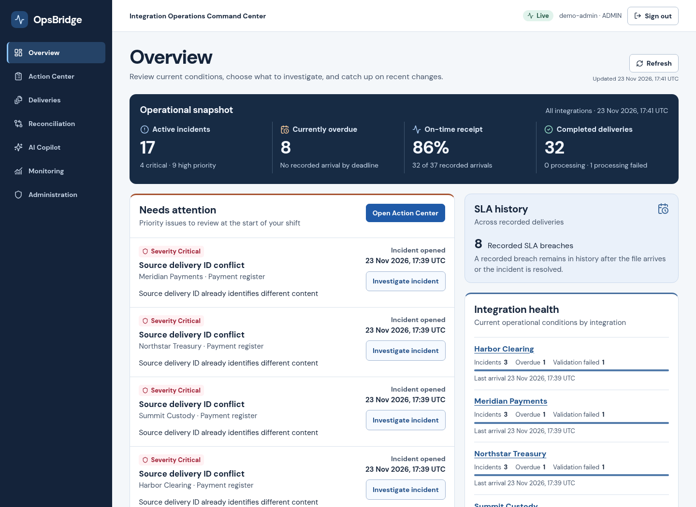
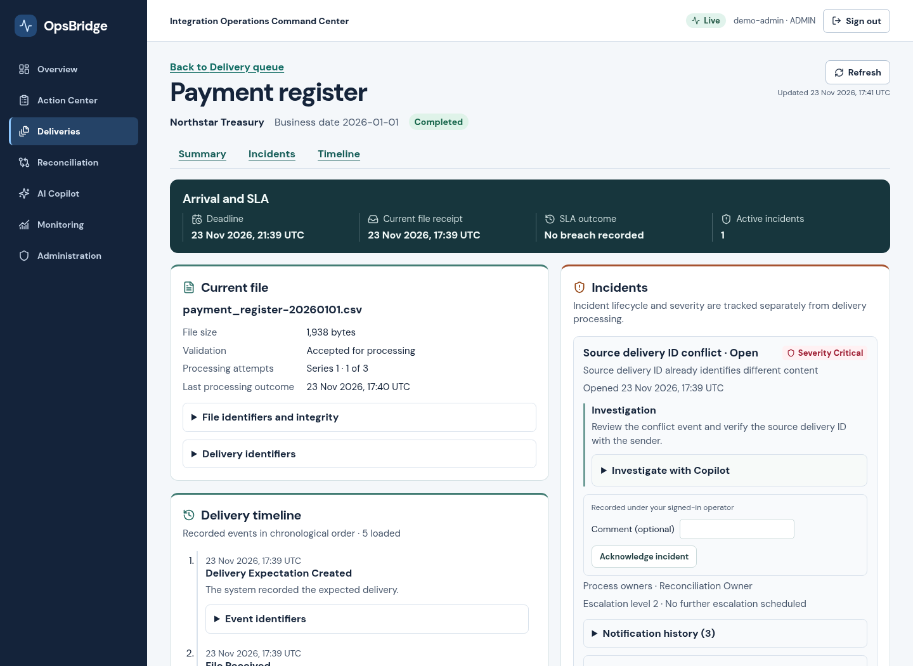
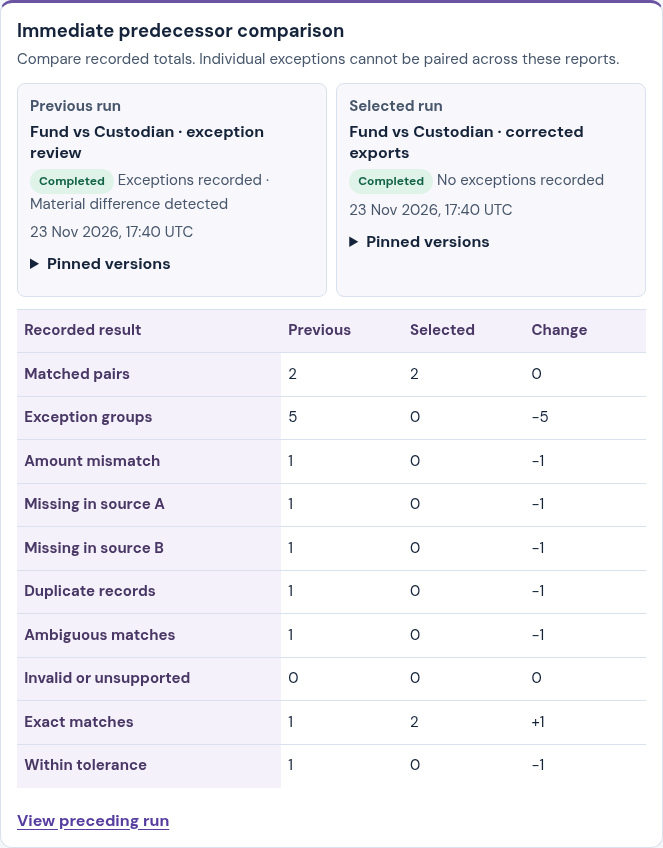
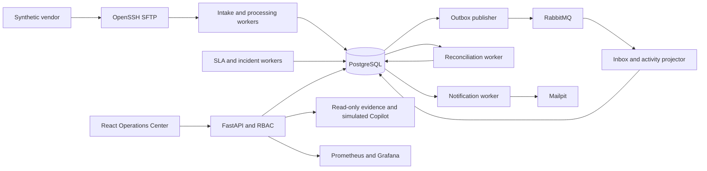

# OpsBridge

OpsBridge is a financial integration operations workbench built with synthetic data. It helps an operations analyst find a missing or failed delivery, review the evidence, and reconcile two independent financial exports. It demonstrates the path from an incoming file to an auditable operator decision.



## What you can demonstrate

- Receive a synthetic financial export through the OpenSSH SFTP subsystem, validate it, retain its receipt history and suppress duplicate business records.
- Investigate late deliveries, validation and processing failures, and source delivery ID conflicts. Review delivery timelines, acknowledge incidents and see escalation emails in Mailpit.
- Compare independent source files with deterministic decimal reconciliation. Inspect mismatched and missing records, ambiguous matches, and the history of corrected reruns.
- Trace events from a PostgreSQL transactional outbox through RabbitMQ to an idempotent inbox and rebuildable activity feed. Browse live dashboard updates and local monitoring.
- Ask the read-only Operations Copilot about an incident. The default provider is labeled **Simulated analysis**. It uses persisted evidence, separates hypotheses from facts and cites records.

<details>
<summary>See delivery evidence and corrected-run comparison</summary>





</details>

## Quick start

Install Git, Python 3.14 and Docker with Compose v2 and Linux containers. From the repository root run one command in PowerShell. On Linux or macOS, use `python3.14` in place of `py -3.14`.

```powershell
py -3.14 scripts/run_portfolio.py
```

The launcher builds the images and starts disposable local services. It checks the new `opsbridge_test` database before applying migrations, creates demo accounts, and sends the synthetic workload through intake and processing. It prompts for a temporary `demo-admin` password. The launch needs no local environment file, SSH key or OpenAI API key. Allow extra time for first-time image downloads.

| View | Default address |
| --- | --- |
| Operations Center | [http://127.0.0.1:8080/overview](http://127.0.0.1:8080/overview) |
| Mailpit | [http://127.0.0.1:8025](http://127.0.0.1:8025) |
| Grafana | [http://127.0.0.1:3000](http://127.0.0.1:3000) |

Press Enter in the launcher to stop the demo and remove its disposable containers. Run again with `--reuse-images` for a fresh dataset without rebuilding. Follow the [13-minute portfolio walkthrough](docs/PORTFOLIO_DEMO.md) for delivery evidence, incident acknowledgement, reconciliation, simulated Copilot and monitoring. See the [Compose intake guide](docs/INTAKE_DEMO.md) for credentialed SFTP integration.

## Architecture



FastAPI and the workers share one Python modular monolith. PostgreSQL, SQLAlchemy and Alembic own operational state and schema. RabbitMQ carries durable event references. React, TypeScript and Vite provide the dashboard through nginx. Docker, Pytest and Chromium/Playwright supply repeatable local verification. See the [architecture](docs/architecture.md) for transactions, security boundaries and recovery behavior.

## Verification and measured behavior

The isolated release run passed 227 backend tests, 22 controlled Chromium tests and 11 live Chromium scenarios. The live run covered successful and duplicate intake, missing files, failed validation, source-ID conflicts, acknowledgement, authorized reprocessing, reconciliation differences, corrected runs, source navigation and cited simulated analysis. The repository includes a GitHub Actions workflow for disposable validation. The [release-readiness report](docs/RELEASE_READINESS.md) records local results and outstanding publication gates. See the [developer setup](docs/DEVELOPER_SETUP.md) to reproduce the checks.

- In a local 1,000-delivery comparison, one checked PostgreSQL connection per event worker reduced observed convergence from 60.81 to 41.17 seconds. Retries after publisher confirmation and consumer interruption preserved one projection per authoritative event. See the [performance report](docs/PERFORMANCE_REPORT.md).
- The offline Copilot met the documented rubric in 15 of 15 synthetic cases. It uses bounded, sanitized, read-only evidence. Its relevance checks are task-specific, and the report contains no real-model results. See the [AI evaluation](docs/AI_EVALUATION_REPORT.md).

## Security, limits and roadmap

Demo services publish their browser ports to loopback. The dashboard uses individual revocable sessions, role checks, CSRF protection and audit records. Mailpit receives synthetic addresses. All data supplied with this repository is intended for demonstration. Keep client files, secrets and real financial data outside the repository.

The deployment is a local portfolio environment. It uses a single database and broker, has bounded reconciliation and evidence windows, and runs without production identity federation, deployment hardening or high availability. The one-command runner uses the OpenSSH SFTP subsystem in direct mode. The separate Compose guide exercises the credentialed network handshake.

The optional server-side OpenAI adapter is implemented. The demo and CI use simulated analysis, and live provider activation and evaluation remain future work. IBM MQ and message-based Order/Confirmation workflows are also outside the implemented scenario. See the [development plan](docs/DEVELOPMENT_PLAN.md) and [current status](docs/DEVELOPMENT_STATUS.md).

## License

Original OpsBridge code is distributed under the [MIT License](LICENSE). Dependencies and separately obtained container images retain their upstream licenses. See the [third-party software notes](docs/PUBLICATION.md#third-party-software).
