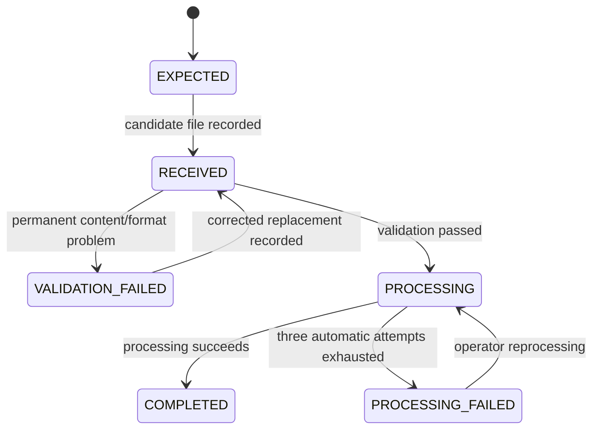
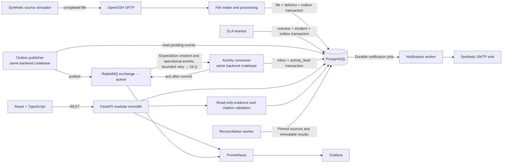
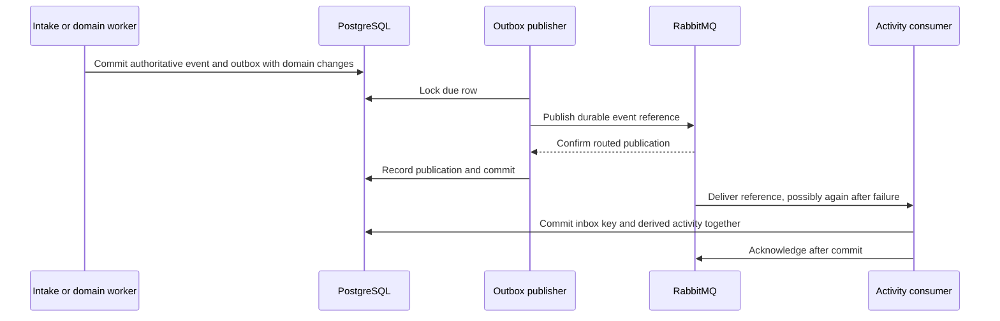

# OpsBridge V1 Architecture

## Business context

Financial operations depend on timely, complete exchanges between systems. Operators need to know whether an expected file arrived, whether it passed validation and processing, whether it met its arrival deadline, and what needs attention. OpsBridge simulates this workbench with synthetic data. It monitors file delivery and operational exceptions; it is not a payment processor or a replacement for source systems.

## Approved V1 scope

V1 implements one file-based scenario: a synthetic source generates financial data, transfers a file over OpenSSH SFTP, and OpsBridge records and processes the delivery. The system monitors arrival deadlines and incidents and presents integration health, delivery status, and event history in a React dashboard.

The backend is a FastAPI modular monolith. PostgreSQL is the source of truth. RabbitMQ carries internal asynchronous events. The publisher, consumer, SLA monitor, API, and intake/processing logic are modules or processes from the same backend codebase, not microservices. The activity consumer projects `DeliveryExpectationCreated` and relevant subsequent operational events, including status changes and file/SLA outcomes, into the derived `activity_feed` read model. It never performs intake or file processing.

V1 uses synthetic data only, UTC timestamps, database integrity constraints, idempotent processing, structured logging, health checks, and locally supplied secrets. The application will connect to RabbitMQ using a dedicated application account, not RabbitMQ's default `guest` account. Local example credentials are placeholders only and are not production credentials. Docker Compose is the planned local runtime; infrastructure is introduced gradually (PostgreSQL in phase 2, SFTP in phase 3, RabbitMQ in phase 5).

## Component responsibilities

| Component | Responsibility |
|---|---|
| Synthetic source simulator | Create fictional delivery expectations/files and upload completed files to SFTP. |
| OpenSSH SFTP | Provide the file-transfer boundary and local inbox. |
| File intake and processing | Discover complete files, identify duplicates, validate content, process valid files, and persist outcomes. It is the sole owner of file processing. |
| FastAPI modular monolith | Expose REST reads and operator actions; apply business rules; coordinate persistence and event creation. |
| PostgreSQL | Store expectations, file attempts, delivery status, authoritative delivery events, incidents, outbox/inbox records, and the derived activity-feed read model. |
| SLA monitor | Periodically find missing arrivals past deadline, record the breach once, and open a missing-file incident. |
| Outbox publisher | Publish committed outbox events to RabbitMQ and mark confirmed publications. |
| RabbitMQ | Route internal events through exchanges and queues; support bounded delayed retries and dead-letter routing. It is not IBM MQ. |
| Activity consumer | Project `DeliveryExpectationCreated` and relevant subsequent operational events into the derived `activity_feed` read model idempotently. It does not fetch, validate, or process files. |
| React + TypeScript dashboard | Display integration health, deliveries, incidents, event history, and activity; support incident acknowledgment/resolution. |

## File workflow

1. Create an expectation with an integration, business date, filename pattern, and UTC arrival deadline.
2. The simulator creates a synthetic file and uploads it to SFTP, using a temporary name then rename or a stable-size check to avoid reading a partial transfer.
3. Intake discovers the completed file, computes a content hash, and associates it with the expected delivery.
4. A database uniqueness constraint prevents the same content from being registered twice for one expectation.
5. Validate filename, format, required columns, business date, and size. Permanent content errors become `VALIDATION_FAILED`; do not retry them automatically.
6. If valid, process with at most three automatic attempts total for transient technical errors. Exhaustion becomes `PROCESSING_FAILED` and opens an incident.
7. On success, set `COMPLETED`. Record status changes and processing attempts in the delivery event history.

An exact duplicate is not processed a second time. A corrected replacement is allowed only after validation failure, is a new file row, and references the prior file via `replaces_file_id`. If the source provides a delivery identifier, retain it and use it as an additional idempotency key where appropriate. The expectation identity is `(integration_id, business_date, delivery_type)`; `expected_pattern` is a supplementary payload-name check. Reuse of a source delivery ID with different content is a conflict, not an overwrite.

## Delivery lifecycle and SLA condition

Delivery statuses are `EXPECTED`, `RECEIVED`, `VALIDATION_FAILED`, `PROCESSING`, `PROCESSING_FAILED`, and `COMPLETED`. Validation failure is permanent for that file. Processing failure is potentially transient and may be retried or reprocessed by an operator. Operator reprocessing records an audit event and begins a new attempt series.



SLA breach is a separate, persistent condition, not a delivery status. `deadline_at` is the expected file-arrival deadline. `overdue_at` is set once when the monitor first detects a missing arrival after the deadline and is never cleared. `received_at` records arrival. Append-only delivery events retain `DeliveryOverdue`, `FileReceived`, and later outcomes.

```mermaid
stateDiagram-v2
    [*] --> WITHIN_SLA
    WITHIN_SLA --> BREACHED: deadline passes without arrival; set overdue_at
    WITHIN_SLA --> ARRIVED_ON_TIME: file arrives by deadline
    BREACHED --> ARRIVED_LATE: file arrives; resolve missing-file incident
```

For example, if the deadline is 10:00, the monitor detects it at 10:01, and the file arrives at 10:15, the expectation keeps `deadline_at=10:00`, `overdue_at=10:01`, and `received_at=10:15`. It may later reach `COMPLETED` at 10:20. The historical breach remains reportable even though the current delivery status is completed. The monitor detection time can lag the deadline by up to its scan interval.

## Database entities and constraints

Use timezone-aware timestamps and store/compare them in UTC. Use foreign keys, `NOT NULL`, status checks, and unique constraints for integrity.

| Entity | Important fields and constraints |
|---|---|
| `integrations` | `id` primary key, `name`, `source_name`, `active`. |
| `delivery_expectations` | `id`, `integration_id` foreign key, `business_date`, textual `delivery_type`, `expected_pattern`, `deadline_at`, nullable `overdue_at`, current `status`; unique `(integration_id, business_date, delivery_type)`. `expected_pattern` validates a payload name and is not part of delivery identity. |
| `files` | `id`, `delivery_expectation_id` foreign key, `original_name`, `content_hash`, optional `source_delivery_id`, `size_bytes`, `received_at`, validation and processing statuses, nullable `replaces_file_id` self-reference. Unique `(delivery_expectation_id, content_hash)`; check `size_bytes >= 0`. Integration is reached through the expectation and is not duplicated here. |
| `delivery_events` | `id`, `delivery_expectation_id` foreign key, nullable `file_id`, `event_type`, `occurred_at`, details; append-only and the authoritative operational event history. |
| `incidents` | `id`, `delivery_expectation_id` foreign key, nullable `file_id`, nullable unique `conflict_key` for source delivery ID conflicts, `incident_type`, `status`, `opened_at`, nullable `acknowledged_at`, nullable `resolved_at`, reason. Prevent duplicate active missing-file incidents per delivery and file-level validation/processing incidents; conflict keys remain unique after resolution. |
| `outbox_events` | `id`, unique `event_id`, event type and payload, `created_at`, nullable `published_at`, publication attempts. |
| `inbox_events` | `event_id` primary key, `received_at`, `processed_at`, outcome; deduplicates consumed messages. |
| `activity_feed` | Derived dashboard read model keyed by source `event_id`, with delivery reference, event type, display summary/payload, and event time. A unique source event ID makes updates idempotent. It is not a second source of truth and can be rebuilt from authoritative `delivery_events` if needed. |

One expectation may have multiple file attempts so a corrected replacement can be retained. V1 permits a corrected replacement only after validation failure; the prior attempt remains auditable. File uniqueness is scoped to its expectation, so `integration_id` need not be copied into `files` merely to deduplicate.

## Incident lifecycle

Incidents are `OPEN`, `ACKNOWLEDGED`, or `RESOLVED`. A missing-file incident opens when the SLA monitor detects overdue delivery and resolves automatically when the expected file arrives. The SLA breach remains in `overdue_at` and delivery history. A subsequent validation or processing failure opens a separate incident. A source delivery ID conflict is associated with the expectation but has no `file_id`. Its stable conflict key prevents duplicate incidents after retries. State changes, operator acknowledgements and resolution reasons are retained for audit.

### Incident notification and escalation

The incident transaction stores its notification jobs in PostgreSQL. The notification worker reads the jobs and sends to the local Mailpit sink outside the incident transaction. SMTP availability has no synchronous effect on opening, acknowledging or resolving an incident. Notification delivery state is separate from incident state and delivery status.

Policies select owners and recipients per event using the integration, incident type and derived severity. The most specific explicitly configured event field wins, with integration specificity followed by incident type and severity. The predefined severities are HIGH for missing file and exhausted processing, MEDIUM for validation, and CRITICAL for source-ID conflicts. Resolution can omit recipients. Opening snapshots future escalation deadlines and recipients. Deadlines are offsets from opening time. Higher levels wait for lower escalation levels to become terminal. An acknowledgement or resolution cancels queued escalation jobs. An SMTP attempt already claimed under the incident row lock may finish.

Jobs have a unique incident, event, escalation level and recipient identity. The worker holds a PostgreSQL advisory lock per job across its SMTP attempt. Attempt start and result are durable. The three-attempt budget includes an interruption with unknown outcome. Transient failures retry after five and twenty seconds. A permanent rejection or exhausted budget leaves a failed job and its attempt history. A stable Message-ID helps investigate duplicate captures. SMTP acceptance can precede a crash before the database records success, so delivery is not exactly once.

Acknowledgement is a deliberate operator action. The API requires an authenticated Operator or Admin and records the account UUID. Comments and actor timestamps are retained even after resolution. Email opens and clicks have no effect.

## RabbitMQ, outbox/inbox, activity feed

The outbox makes database changes and event intent durable together without a distributed transaction. The inbox makes duplicate message delivery harmless. `delivery_events` remains the authoritative operational event history; `activity_feed` is only a derived read model for dashboard presentation. The future RabbitMQ consumer projects `DeliveryExpectationCreated` and subsequent dashboard-relevant events from the outbox, correlating each projection row to its authoritative event. It updates that projection idempotently, and the projection can be rebuilt from `delivery_events` if it is lost or needs repair.

```mermaid
sequenceDiagram
    participant Intake as File intake
    participant DB as PostgreSQL
    participant Pub as Outbox publisher
    participant MQ as RabbitMQ exchange/queue
    participant Consumer as Activity consumer

    Intake->>DB: Transaction: record file, delivery, event, outbox row
    DB-->>Intake: Commit
    Pub->>DB: Read unpublished outbox event
    DB-->>Pub: DeliveryExpectationCreated or operational event + event_id
    Pub->>MQ: Publish; wait for broker confirmation
    MQ-->>Pub: Confirm
    Pub->>DB: Mark outbox row published
    MQ->>Consumer: Deliver event
    Consumer->>DB: Transaction: insert inbox event_id + update activity_feed
    DB-->>Consumer: Commit
    Consumer->>MQ: Acknowledge after commit
```

For a file receipt, intake records the file, sets delivery status/arrival time, appends authoritative `FileReceived` to `delivery_events`, resolves an active missing-file incident if one exists, and inserts a `DeliveryStatusChanged` outbox row in one PostgreSQL transaction. If that transaction fails, none of those changes commit. After commit, the publisher sends the event. If it crashes after broker confirmation but before marking the row published, it may publish again; the unique inbox event ID and unique source event ID in `activity_feed` prevent duplicate activity entries.

The consumer transaction inserts the event ID into `inbox_events` and upserts the corresponding `activity_feed` row together. Essential projection fields are the source event ID, delivery reference, event type, display summary or safe payload, and event timestamp. It acknowledges the RabbitMQ message only after commit. On failure, no acknowledgment is sent; bounded message retries follow. The consumer never repeats intake or file processing. The feed is disposable and reconstructable; operational decisions and reporting use authoritative delivery state and `delivery_events`.

## Retry, publication, and dead-letter rules

Keep three mechanisms separate:

1. **File-processing retry:** at most three automatic attempts total, only for transient technical errors after validation. Permanent validation errors are not retried. After exhaustion, mark `PROCESSING_FAILED` and open an incident. Operator reprocessing is explicit, audited, and starts a new attempt series.
2. **Outbox publication retry:** the publisher retries unpublished outbox rows until RabbitMQ confirms publication. This retries sending an event; it does not rerun file processing.
3. **RabbitMQ message redelivery:** if the activity consumer fails before its database transaction commits, the message is retried. Use a bounded retry queue/delay and then a DLQ. Do not use immediate infinite requeue loops. Message redelivery does not rerun file processing.

The outbox row and business state commit together. Consumer inbox and activity-feed effects commit together. Acknowledge a message only after consumer commit. Events and logs must carry correlation/event identifiers without exposing secrets or full sensitive file contents.

## High-level architecture





The [portfolio walkthrough](PORTFOLIO_DEMO.md) links these boundaries to the live dashboard and synthetic records. The [release readiness review](RELEASE_READINESS.md) records the remaining publication and deployment prerequisites.

## Observability and dashboard updates

The API and worker processes emit JSON records with a UTC timestamp, severity, process name and a stable operation code. The API validates or assigns a UUID request ID and returns it in `X-Request-ID`. Public route templates and status codes are safe to log. Matching identifiers are included where the operation provides them. Request IDs on API-originated domain events travel with the durable outbox record. Publisher and consumer records can be matched by event ID. Business payloads, CSV contents, URL queries, mail addresses and exception messages are excluded.

`GET /health` reports API process liveness. `GET /ready` checks PostgreSQL connectivity, the observability schema and AMQP authentication when a RabbitMQ URL is configured. An unconfigured broker is reported explicitly and is optional for the standalone API. Workers expose the last observed readiness state on their metrics ports. Prometheus also checks whether each process is scrapeable. Readiness does not shut down the API or trigger a restart.

Prometheus scrapes API response and worker operation metrics, durable PostgreSQL aggregates, and RabbitMQ queue depths. Durable counters come from operational records, so restarting a worker does not reset them. API and worker process metrics reset on restart. Metric dimensions are restricted to bounded values such as a route template, operation, status family or incident type. Grafana and Prometheus are loopback-only in the local monitoring profile. See [the metrics and dashboard guide](DASHBOARD_DEMO.md#live-operations-and-monitoring).

PostgreSQL triggers signal dashboard invalidation after commits to the tables that back dashboard responses. Identical notifications coalesce within each transaction. Each API process uses one shared `LISTEN` connection and sends a payload-free SSE signal through `/dashboard/stream`. Clients re-read existing API endpoints and catch up on every new subscription, including after an outage. They coalesce bursts, poll every 15 seconds when disconnected, and retain manual refresh. The stream is ephemeral. Historical reconstruction still uses PostgreSQL and its existing delivery events.

## Operations Copilot

The Copilot is a read-only tool in the same modular monolith. The incident action pins a persisted incident UUID. A small English question grammar maps supported questions to fixed SQLAlchemy queries for unresolved incidents, recorded SLA breaches, recent problems, delivery failures and the timeline before acknowledgement. The model cannot choose a query, access files, or invoke actions. PostgreSQL enforces a short read-only repeatable-read transaction. It ends before the provider is called.

Evidence contains typed observations, bounded by source and ordered with stable record IDs. The Copilot builds its facts locally. The configured model selects which observations to emphasize and ranks investigation paths supported by that evidence. It returns only evidence references and investigation keys. The server rejects unknown keys, duplicates and unexpected properties, then fills in facts, hypotheses and recommendations from the approved evidence and templates. Citations in the dashboard map the references to persisted IDs and UTC timestamps. The offline provider makes a deterministic selection and is labeled **Simulated analysis**.

The external adapter receives an operation name, normalized facts, timestamps, temporary per-request reference labels and the eligible investigation paths. Original IDs and integration names stay local. The outbound request excludes the operator's wording, CSV contents, filenames, descriptions, arbitrary event payload fields, operator comments, notification addresses and credentials. Treat persisted free text as untrusted even when it originates inside OpsBridge. The provider has a deadline, at most two HTTP attempts, a bounded response, and fixed-label latency, outcome and token metrics. Copilot endpoints require the Viewer role or higher. Retention review and organization-specific data approval are separate deployment decisions.

See [the Operations Copilot demo](DASHBOARD_DEMO.md#operations-copilot) for provider configuration and example investigations.

The [AI evaluation lab](AI_EVALUATION_REPORT.md) uses these same boundaries with disposable PostgreSQL data. It records retrieval and selection findings separately and defaults to a network-isolated mock provider.

## Financial reconciliation

A reconciliation definition binds two independent integrations through their delivery expectations. Each expectation supplies the business date and expected input type. The definition selects record ID or reference, an inclusive decimal tolerance, and optional exception-count, materiality, missing-arrival and execution-failure policies. Definitions and run identity are immutable. A corrected export can be registered under a separate input type for the same integration and date and linked to a preceding run through a new definition.

The reconciliation worker waits for both deliveries and their current files to be completed. It pins the specific files and reads only finalized accepted snapshots after verifying size and SHA-256. A session-level advisory lock protects the run across the read and comparison. The persisted attempt start survives interruption. Recovery takes the same lock, uses the same pins and consumes another attempt. Transient storage failures retry with bounded backoff. Matching and persistence use the pinned input pair. Final snapshots, result groups, incident effects and audit outbox entries commit together.

The matcher groups by date, trimmed case-sensitive identifier and uppercase three-letter currency. It uses exact decimal arithmetic with up to eighteen integral digits and six fractional digits. An input with an unsupported date, key, currency shape or precision produces an invalid group. A unique pair can match exactly, fall within tolerance or have an amount mismatch. A one-sided key yields a missing group. A repeated key and equal normalized amount on either side classifies the group as duplicate. Multiple distinct candidates classify the group as ambiguous. Both cases leave the group unpaired. Sorting and stable snapshot positions make results independent of input order.

Operational incidents summarize run-level conditions. Amount materiality uses the absolute difference for an individual amount mismatch or missing group. It is inclusive and never aggregates currencies. A configured missing-file rule can open an incident while the run still waits. A clean completion below the configured thresholds resolves that incident. A run owns at most one reconciliation incident. Individual groups remain traceable in immutable results. The existing notification, escalation, transactional outbox, RabbitMQ consumer and activity feed handle run events and incidents. The Copilot reads classifications and counts with stable citations and leaves amounts and source rows out of provider requests.

## Operator authentication and authorization

PostgreSQL stores individual operator accounts and per-account salted Argon2id password hashes. Session cookies carry an opaque random token. The database stores its SHA-256 digest with an absolute eight-hour expiry. The cookie uses the `__Host-` prefix, Secure, HttpOnly, SameSite Strict and path `/`. Browser and API traffic share an origin. Outside the loopback demo, use HTTPS and keep the backend service private. The login route requires an explicit same-origin request header. Unsafe session requests require a matching per-session CSRF token. The browser keeps that token in memory and reloads it from its authenticated session after a refresh.

The API requires authentication by default. Viewer can read records, reconciliation, activity, SSE and Copilot. Operator also acknowledges incidents, queues eligible reprocessing and creates confirmed reconciliation reruns. Admin also creates integrations and expectations, provisions and manages accounts and roles, and changes notification and reconciliation policies. The API enforces roles and derives operator attribution from the account UUID. Reconciliation policy changes are new named definitions. Existing definitions and results remain immutable. Notification policy changes affect future job creation. Previously created notification jobs retain their recipients and schedule.

Logout deletes the current session. Role changes, account deactivation and password resets delete every session for that account. SSE authorizes the initial subscription and rechecks active sessions at ten-second intervals when messages or heartbeats are sent. In-flight requests can finish under the permissions checked when they started. The append-only ledger records login successes, failures and per-account throttling, plus logout, administrative changes and operational actions. The login handler allows at most four concurrent checks and 60 admitted attempts per minute per API process. A known account gets up to five failed checks per minute across processes. Requests rejected at process admission count toward HTTP metrics. Business mutations write security audit entries in their own transaction together with the change. Credentials, cookie values, CSRF tokens and request bodies are excluded from audit records.

Workers use their PostgreSQL, broker, storage and Mailpit service configuration independently of operator sessions. Only `GET /health`, `GET /ready` and `GET /metrics` are exempt from session checks besides login. The Compose browser proxy omits all three monitor paths. They remain private to the backend network and its infrastructure callers. Public deployment needs an edge TLS policy, separate machine database privileges and monitored login throttling. The local implementation has no MFA, SSO, self-service recovery or distributed rate limiter.

## Architectural trade-offs

- **Modular monolith over microservices:** keeps local operation, transactions, and learning manageable while retaining clear code boundaries. It gives up independent scaling/deployment, which V1 does not need.
- **PostgreSQL for operational state:** relational constraints protect delivery integrity and make investigation queries direct. `delivery_events` is authoritative; the rebuildable activity feed is a presentation read model, not a second source of truth.
- **RabbitMQ with outbox/inbox:** demonstrates asynchronous delivery with recoverable publication and idempotent consumption. It adds background-process and retry configuration, so use it for the activity feed rather than duplicating file work.
- **Polling SLA monitor:** recovers missed deadlines after restart and is simple to reason about. Detection can lag the deadline by one scan interval.
- **Hash deduplication scoped to an expectation:** simple unique constraint and replacement history without duplicating integration identity on files.
- **Local Compose infrastructure, phased:** allows realistic local execution while avoiding premature services and configuration complexity.

## Future Architecture: Message-Based Integrations (V2)

This section records a future direction only. It is not part of V1 scope and must not drive V1 database or implementation complexity.

Some enterprise integrations begin with batch Order and Confirmation files over SFTP and later migrate to individual Order and Confirmation messages over IBM MQ. A future OpsBridge version may demonstrate that migration and monitor message delivery, processing, and business confirmation using `order_id` and `correlation_id`. It could detect missing, delayed, duplicated, or rejected messages, track retries and dead letters, and show the same business process first as files and later as messages.

RabbitMQ in V1 demonstrates asynchronous internal messaging patterns; **RabbitMQ is not IBM MQ**. IBM MQ support is only a potential V2 adapter. Do not install, configure, or implement IBM MQ or message-based Order/Confirmation processing in V1. Keep V1 concepts generic where natural (integration, delivery, event), but do not add speculative abstractions or change the V1 schema for this future scenario.
